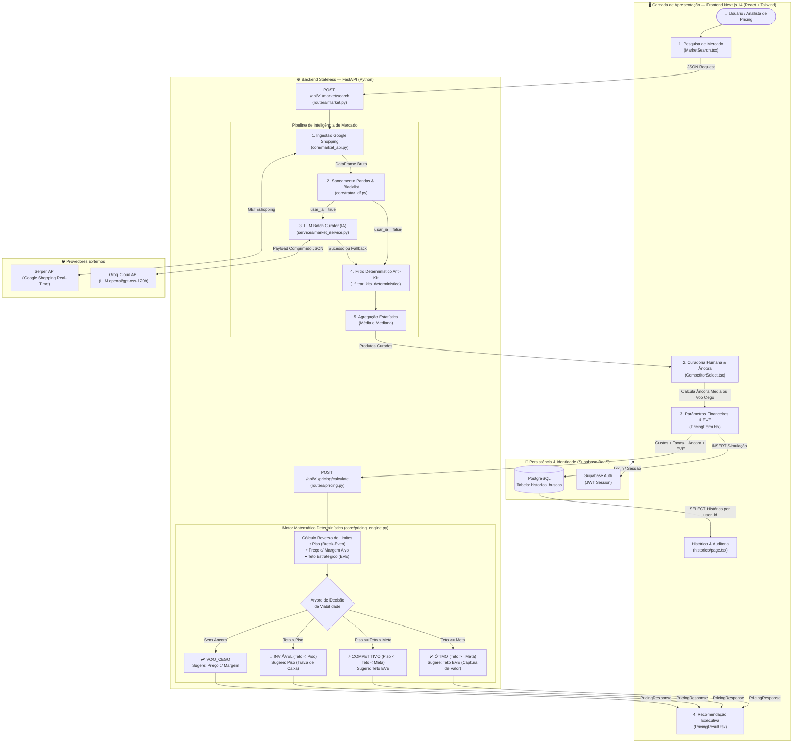

# 💸 Conecta Price V2 (Pricing Inteligente)

Um sistema avançado de precificação para e-commerce e varejo, movido a Inteligência Artificial e dados de mercado em tempo real. Este projeto utiliza uma **Arquitetura API-First** totalmente desacoplada, conectando um motor analítico e matemático em **FastAPI (Python)** a uma interface moderna em **Next.js 14 (React + TypeScript + Tailwind CSS)** e persistência em nuvem via **Supabase (PostgreSQL)**.

---

## 🏗️ Arquitetura do Sistema (Fluxograma End-to-End)

A arquitetura foi desenhada separando um **Backend Stateless de Computação e Inteligência (FastAPI)** de uma camada de **Apresentação e Persistência BaaS (Next.js 14 + Supabase)**, garantindo escalabilidade, baixa latência e resiliência contra falhas de APIs externas.



---

## 📐 Modelagem Matemática e Regra de Negócio (Pricing Engine)

Diferente de soluções baseadas puramente em tentativa e erro ou em "caixas-pretas" generativas, o **Conecta Price V2** separa claramente as responsabilidades:
1. **A Inteligência Artificial (LLM)** atua exclusivamente no **saneamento semântico da amostra de mercado** (expurgando kits, fardos de atacado e produtos divergentes vindos de descrições técnicas de ERP).
2. **O Motor Financeiro (`backend/app/core/pricing_engine.py`)** executa um **modelo matemático determinístico** para encontrar o ponto ótimo entre a proteção de caixa e a captura máxima de valor no mercado.

### 1. O Conceito de Markup Reverso (Divisor vs. Multiplicador)

Um erro comum no varejo é calcular o preço somando a comissão e a margem desejada diretamente sobre o custo (multiplicação simples). Na prática comercial, **tanto a comissão do marketplace quanto a margem líquida incidem sobre o Preço Final de Venda ($P$)**.

Para que a receita líquida após os descontos cubra exatamente os custos diretos e preserve a margem planejada, o motor parte da identidade fundamental de formação de preço:

$$P - (P \cdot t_{\text{comissão}}) - (P \cdot m_{\text{alvo}}) = C_{\text{base}} + F_{\text{fixo}}$$

Isolando o Preço de Venda ($P$), obtemos a fórmula de **Markup por Divisor Reverso**:

$$P = \frac{C_{\text{base}} + F_{\text{fixo}}}{1 - t_{\text{comissão}} - m_{\text{alvo}}}$$

Onde:
* $C_{\text{base}}$ (`custo_base`): Custo de aquisição unitário do produto (em `R$`).
* $F_{\text{fixo}}$ (`frete_fixo`): Custo logístico fixo de envio por unidade vendida (em `R$`).
* $t_{\text{comissão}}$ (`taxa_comissao`): Taxa percentual retida pelo canal/marketplace em formato decimal (ex: `15%` = `0.15`).
* $m_{\text{alvo}}$ (`margem_alvo`): Margem de lucro líquida desejada sobre o preço de venda em formato decimal (ex: `10%` = `0.10`).
* **Restrição de Domínio**: A soma $(t_{\text{comissão}} + m_{\text{alvo}})$ deve ser estritamente menor que $1.0$ (`100%`), caso contrário a operação é matematicamente impossível (bloqueada tanto no frontend quanto no motor com `HTTP 422`).

---

### 2. As 3 Fronteiras de Preço do Motor

A cada simulação, o `pricing_engine.py` calcula três balizas financeiras:

#### A) Preço Piso (*Break-Even* / Ponto de Equilíbrio)
É o preço mínimo absoluto pelo qual o produto pode ser vendido sem gerar prejuízo de caixa (Margem Líquida = `0%`). Ele cobre integralmente o custo do produto, o frete fixo e a comissão do marketplace sobre a própria venda:

$$\text{Piso} = \frac{C_{\text{base}} + F_{\text{fixo}}}{1 - t_{\text{comissão}}}$$

#### B) Preço com Margem Alvo (Meta Interna)
É o preço de venda ideal sob a ótica estritamente interna da empresa, garantindo que todos os custos e taxas sejam pagos e que sobre exatamente o percentual `margem_alvo` sobre o faturamento bruto:

$$\text{Preço}_{\text{Meta}} = \frac{C_{\text{base}} + F_{\text{fixo}}}{1 - t_{\text{comissão}} - m_{\text{alvo}}}$$

#### C) Preço Teto de Mercado (Posicionamento Estratégico EVE)
Representa o limite máximo de preço que o mercado aceita pagar pelo seu produto, ancorado na média dos concorrentes selecionados ($P_{\text{âncora}}$) e modulado pelo **Fator EVE (*Economic Value Estimation*)**, que varia de `-10%` (`-0.10`) a `+10%` (`+0.10`):

$$\text{Teto}_{\text{EVE}} = P_{\text{âncora}} \times (1 + f_{\text{EVE}})$$

| Faixa do Fator EVE | Classificação Tática | Objetivo de Negócio no Varejo |
| :---: | :--- | :--- |
| **`-10%` a `-5%`** | 🔥 **Giro Agressivo** | Penetração rápida de mercado, queima de estoque parado e ganho de volume com sacrifício de margem. |
| **`-4%` a `-1%`** | 🎯 **Vantagem Tática** | Posicionamento ligeiramente abaixo da concorrência para vencer leilões de clique e conquistar a *Buy Box* do Google Shopping. |
| **`0%`** | ⚖️ **Par com o Mercado** | Alinhamento neutro de preço; a decisão de compra do cliente será definida por frete, prazo e reputação da loja. |
| **`+1%` a `+5%`** | ⭐ **Prêmio de Serviço** | Cobrança de *spread* positivo sustentada por diferenciais claros (entrega expressa, atendimento superior ou confiança da marca). |
| **`+6%` a `+10%`** | 💎 **Premium / Escassez** | Justificável quando há ruptura de estoque nos concorrentes, exclusividade de distribuição ou venda consultiva. |

---

### 3. Árvore de Decisão e Classificação de Viabilidade

Com o **Piso**, o **Preço com Margem Alvo** e o **Teto EVE** calculados, o motor executa sua árvore de decisão determinística para definir o **Preço Sugerido (`preco_sugerido`)** e o **Status da Operação**:

| Condição Avaliada | Status da Operação | Viável? | Preço Sugerido pelo Motor | Racional Executivo da Decisão |
| :--- | :--- | :---: | :---: | :--- |
| **`preco_concorrente` é `None` ou `<= 0`** | 🛩️ **`VOO_CEGO`** | `True` | $\text{Preço}_{\text{Meta}}$ | Quando o produto é exclusivo ou o analista opta por não selecionar concorrentes, o motor opera sem âncora externa e crava o preço na **Margem Alvo interna**. |
| **`Teto < Piso`** | 🚫 **`INVIÁVEL`** | `False` | $\text{Piso}$ | O preço máximo suportado pelo mercado está abaixo do seu custo de *break-even*. Acompanhar a concorrência geraria prejuízo direto a cada unidade vendida. O motor aciona a **trava de redução de danos**, forçando o preço sugerido para o **Piso**. |
| **`Piso <= Teto < Preço_Meta`** | ⚡ **`COMPETITIVO/SUB-ÓTIMO`** | `True` | $\text{Teto}_{\text{EVE}}$ | A operação é financeiramente saudável (gera lucro positivo acima do Piso), porém o mercado não comporta a totalidade da sua Margem Alvo. O motor sugere o **Teto EVE** para maximizar o lucro possível sem perder competitividade, informando exatamente quantos reais faltam para atingir a meta. |
| **`Teto >= Preço_Meta`** | ✅ **`ÓTIMO`** | `True` | $\text{Teto}_{\text{EVE}}$ | Cenário de **captura máxima de valor (*surplus*)**. Como o mercado aceita pagar um valor superior à sua meta interna, o motor NÃO deixa dinheiro na mesa: em vez de cobrar apenas o $\text{Preço}_{\text{Meta}}$, ele sugere o **Teto EVE**, convertendo a diferença em margem líquida extra para o varejista. |

---

### 4. Exemplo Prático Passo a Passo (Simulação Real)

Suponha um produto com os seguintes parâmetros operacionais:
* **Custo Base ($C_{\text{base}}$):** `R$ 50,00`
* **Frete Fixo ($F_{\text{fixo}}$):** `R$ 10,00` *(Custo Direto Total = `R$ 60,00`)*
* **Comissão do Marketplace ($t_{\text{comissão}}$):** `15%` (`0.15`)
* **Margem Alvo ($m_{\text{alvo}}$):** `10%` (`0.10`)
* **Fator EVE ($f_{\text{EVE}}$):** `0%` *(Par com o mercado)*

**Passo 1 — Cálculo dos Limites Internos:**
1. **Piso (Break-Even):**
   $$\text{Piso} = \frac{50 + 10}{1 - 0,15} = \frac{60}{0,85} = 70,59$$
   *(Se vender por `R$ 70,59`, paga `R$ 10,59` de comissão de 15% e sobram exatos `R$ 60,00` para pagar produto e frete).*
2. **Preço c/ Margem Alvo:**
   $$\text{Preço}_{\text{Meta}} = \frac{50 + 10}{1 - 0,15 - 0,10} = \frac{60}{0,75} = 80,00$$
   *(Se vender por `R$ 80,00`, paga `R$ 12,00` de comissão de 15%, `R$ 60,00` de custos diretos e sobram `R$ 8,00` de lucro líquido = exatos `10%` de `R$ 80,00`).*

**Passo 2 — Avaliação frente a 3 cenários de Concorrência (`Teto EVE`):**
* **Cenário 1 (Concorrentes a `R$ 68,00`):** Como `Teto (R$ 68,00) < Piso (R$ 70,59)`, o motor classifica como **`INVIÁVEL`** e trava o preço sugerido em **`R$ 70,59`** para impedir queima de caixa.
* **Cenário 2 (Concorrentes a `R$ 76,00`):** Como `Piso (R$ 70,59) <= Teto (R$ 76,00) < Meta (R$ 80,00)`, o motor classifica como **`COMPETITIVO/SUB-ÓTIMO`**, sugere **`R$ 76,00`** (garantindo lucro positivo) e avisa que faltam `R$ 4,00` para atingir a meta de 10%.
* **Cenário 3 (Concorrentes a `R$ 88,00`):** Como `Teto (R$ 88,00) >= Meta (R$ 80,00)`, o motor classifica como **`ÓTIMO`** e sugere **`R$ 88,00`**, capturando `R$ 8,00` adicionais por unidade além da margem planejada.

---

## 🚀 Principais Funcionalidades

1. **Pesquisa de Mercado Inteligente:**
   - Varredura em tempo real no Google Shopping via **Serper API**.
   - **LLM Batch Curator:** Utiliza IA (Chain of Thought via Groq/OpenAI) para filtrar "sujeiras" comuns de varejo, como kits de atacado, produtos similares de marcas erradas ou gramaturas diferentes.
   - Opção de busca Rápida (Dados brutos) ou Inteligente (Filtro Semântico IA).
   
2. **Motor Financeiro (Pricing Engine):**
   - Cálculo reverso para garantir a Margem de Lucro Alvo.
   - Aplicação de Custos Fixos, Frete e Comissões de Marketplace.
   - **Fator EVE (Estratégia de Valor e Escassez):** Posicionamento dinâmico que vai desde o Giro Agressivo (Queima de Estoque) até Vantagem Tática em Leilões de Buy Box, ou Prêmio de Serviço.
   - "Voo Cego": Precificação matemática baseada puramente em custos quando não há âncora de mercado.

3. **Interface Guiada & Auditoria de Simulações:**
   - Aplicação web moderna em **Next.js 14 (React + TypeScript)** com **Tailwind CSS**, estruturada em um fluxo decisório de 4 etapas.
   - Autenticação de usuários e persistência de histórico de simulações no **Supabase (PostgreSQL)**.

## 🛠️ Tecnologias Utilizadas

### Backend (Cérebro)
* **Python & FastAPI:** Motor de alta performance para exposição da API REST.
* **Pandas:** Saneamento vetorizado de dados e aplicação de *blacklists* por expressão regular.
* **Groq Cloud:** Provedor de inferência LLM de baixa latência para curadoria semântica de ofertas.
* **Serper API:** Consulta em tempo real aos dados do Google Shopping.
* **Loguru:** Rastreamento e logs estruturados do pipeline de dados.

### Frontend & Persistência
* **Next.js 14 & React 18 (TypeScript):** Interface rica, responsiva e tipada ponta a ponta com os contratos do backend.
* **Tailwind CSS:** Estilização *utility-first* (Design System Conecta Price).
* **Supabase (Auth & PostgreSQL):** *Backend-as-a-Service* para gestão de sessão JWT e armazenamento do histórico de precificações.

---

## ⚙️ Como Executar Localmente

### 1. Preparação (Variáveis de Ambiente)
Crie arquivos `.env` nas respectivas pastas e preencha com suas chaves reais (estas pastas já estão protegidas no `.gitignore`):

**Backend (`backend/.env`)**
```env
GROQ_API_KEY=sua_chave_groq
SERPER_API_KEY=sua_chave_serper
```

**Frontend Next.js (`frontend/.env.local`)**
```env
NEXT_PUBLIC_SUPABASE_URL=sua_url_supabase
NEXT_PUBLIC_SUPABASE_ANON_KEY=sua_chave_anon_supabase
NEXT_PUBLIC_API_URL=http://localhost:8000
```

---

### 2. Rodando o Motor (Backend)
No seu terminal principal, ative o ambiente virtual e rode o FastAPI:
```bash
cd backend
pip install -r requirements.txt
uvicorn app.main:app --reload --port 8000
```
O servidor estará rodando em `http://localhost:8000`. Você pode ver a documentação interativa da API em `http://localhost:8000/docs`.

---

### 3. Rodando a Interface (Frontend Next.js)
Abra um novo terminal e rode:
```bash
cd frontend
npm install
npm run dev
```
Acesse `http://localhost:3000` no navegador.

---

## 🔒 Segurança
O projeto já conta com um `.gitignore` rigoroso que bloqueia qualquer upload acidental de arquivos `.env` ou artefatos de build para proteger suas chaves de API contra vazamentos.

## 📝 Licença
Distribuído sob a licença GNU. Veja o arquivo `LICENSE` para mais detalhes.
